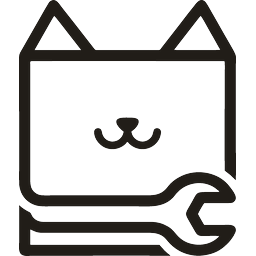
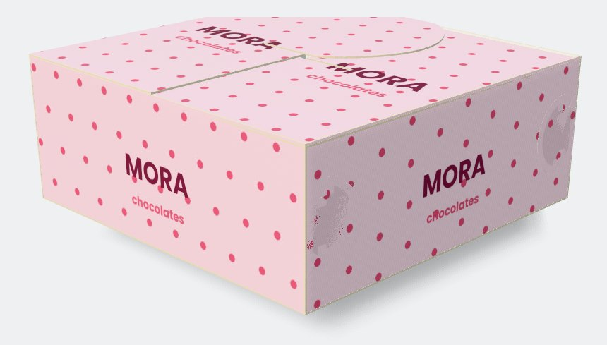
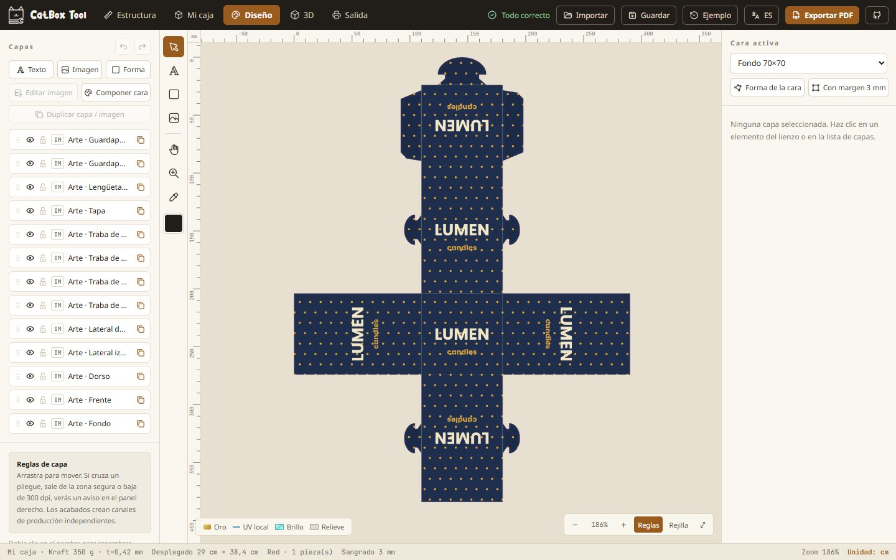
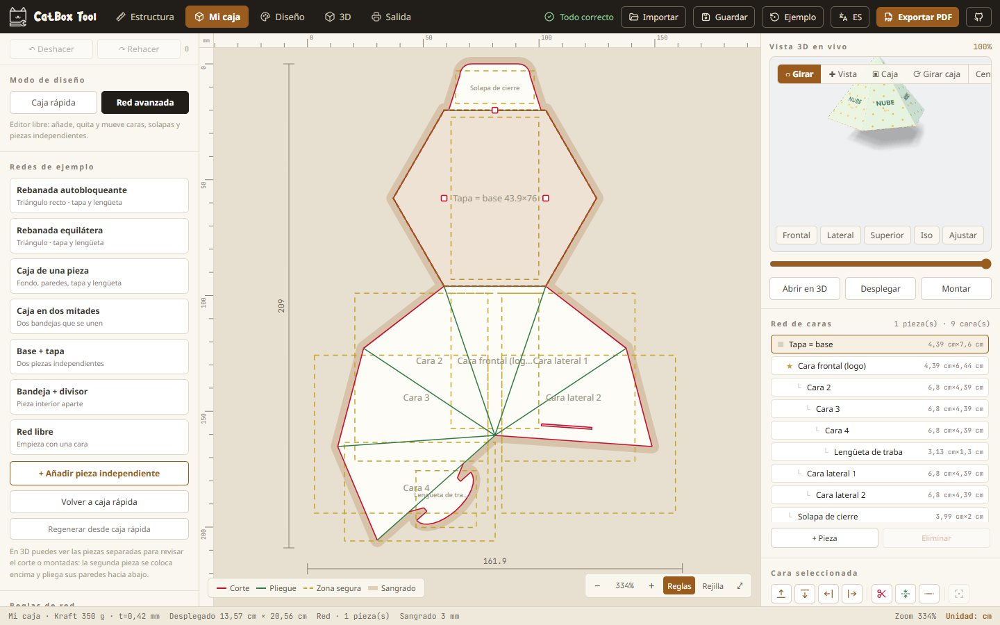
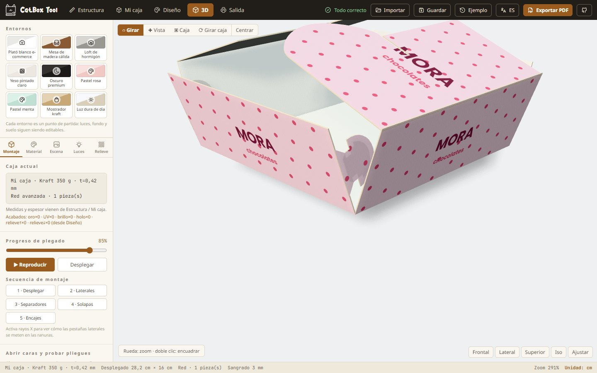
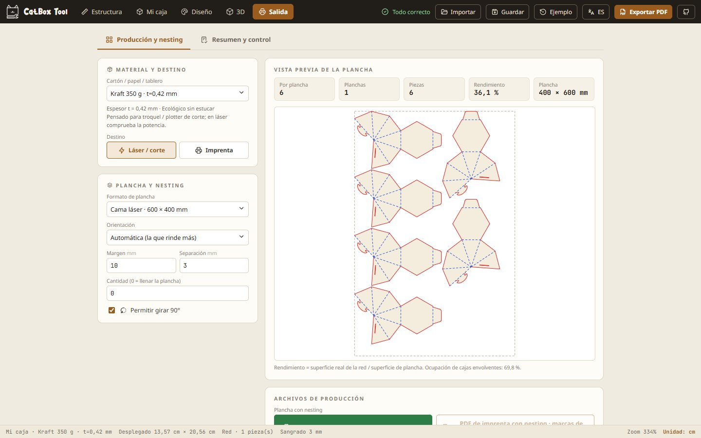

<div align="center">



# CatBox Tool

**Estudio de packaging para diseñar cajas: troqueles paramétricos, constructor de redes libre, diseño por capas con acabados, editor de imágenes, plegado 3D y archivos de producción para láser e imprenta.**

**Packaging studio for designing boxes: parametric dielines, a free-form net builder, layer design with print finishes, an image editor, 3D folding preview and production files for laser cutters and print shops.**

[Español](#español) · [English](#english) · 中文 (UI)



</div>

> **Basado en / Based on [OpenBox3D](https://github.com/yuyou-dev/OpenBox3D)** by yuyou-dev (MIT).

<sub>Las capturas usan cajas de demostración con marcas ficticias. / Screenshots use demo boxes with fictional brands.</sub>

| Diseño por cara / Per-face design | Constructor de redes / Net builder |
|---|---|
|  |  |
| **Plegado 3D / 3D folding** | **Producción y nesting / Production and nesting** |
|  |  |

---

## Español

CatBox Tool adapta OpenBox3D al español, inglés y chino, suma herramientas para construir cajas, un sistema de producción más completo, una app de escritorio (Rust/Tauri) y una interfaz y vista 3D mejoradas.

### Funciones

- **Biblioteca de troqueles**: tuck inverso y recto, caja de envío, tapa y base, cajón, cilindro, hexágono y envolvente, con compensación de espesor, sangrado y zona segura.
- **Mi caja**: caja paramétrica rápida o editor de red avanzado, con reglas, guías y desplazamiento fino.
  - **Empezar desde cero** con una base cuadrada, rectangular, triangular, de trapecio, hexagonal u octogonal.
  - **Paleta de formas y solapas**: arrastra una cara o solapa hasta cualquier borde y se pega sola; también con los «+» de cada borde libre. Una solapa se puede pegar en otra solapa.
  - **Lados reales**: en triángulos y cualquier silueta no rectangular, las solapas se apoyan en los lados de verdad y se recortan en inglete para no pisarse en las esquinas.
  - **Perfiles de solapa**: recta, lengüeta, guardapolvo, pegado, asimétrica (recta de un lado, en ángulo del otro), circular, recta + curva, redondeada, seta; inglete y radio de esquina por lado.
  - **Forma libre**: cualquier cara se convierte en vértices editables (arrastrar, añadir, borrar).
  - **Todo editable**: cada lado puede ser corte, pliegue, punteado o sin línea (también la bisagra), curvarse hacia fuera o hacia dentro, y cada esquina tener su propio radio: una solapa puede ser recta de un lado y redonda del otro.
  - **Plegado**: sentido (valle/monte) y ángulo de cada cara, con marcas V/M y el ángulo en cada bisagra del plano.
  - **Cortes, pliegues, punteado (perforación), ranuras con extremos redondeados y agujeros circulares**, también visibles como huecos en 3D. Cualquier línea o ranura se curva arrastrando el rombo de su centro (como en Corel).
- **Caras de forma libre** en archivos: una cara con `shape: "poly"` lleva su propio contorno en `pts` (mm locales, bisagra de `[0,0]` a `[w,0]`).
- **Cajas autobloqueantes sin pegamento**: lengüetas tipo hongo que pasan por ranuras de 0,8 mm, trabas de esquina y tapas con solapa de una sola pieza.
- **Revisión automática**: detecta caras, solapas y ranuras incoherentes y sugiere correcciones.
- **Diseño estilo Photoshop**: barra de herramientas con atajos (mover, texto, formas, imagen, mano, zoom, cuentagotas), transformar con tiradores, panel de capas (reordenar, bloquear, opacidad, modos de fusión), alinear y distribuir, selección múltiple y transformación en grupo, degradados, sombras, contorno de texto, máscara de recorte, **grupos de capas**, **máscaras de capa pintables** (no destructivas), guías inteligentes y portapapeles.
  - **Pensado para caras no rectangulares**: fondo con la forma exacta de la cara (triángulo, hexágono…), rellenar o ajustar a la cara real, centrar en el centroide y alinear con un borde.
  - Acabados por capa (oro/plata, UV, brillo, holográfico, relieve). Cada capa se recorta a la cara a la que pertenece.
- **Editor de fotos**: selecciones (marco, lazo, varita), pinceles, tampón de clonar, degradado, bote de pintura, desenfocar/enfocar/dedo, sobreexponer/subexponer, capas de ajuste (niveles, curvas, tono/saturación…), filtros, máscaras de capa, 16 modos de fusión e historial.
- **Módulos de IA descargables** (se bajan una vez y quedan guardados): ampliar ×2/×4 (waifu2x, Real-ESRGAN), reducir ruido y quitar fondo (U²-Netp), sin GPU.
- **Tipografías del sistema**: el selector de fuentes lista las instaladas en el equipo, con búsqueda y vista previa.
- **Plantilla de referencia en Mi caja**: un DXF, SVG, PNG o JPG semitransparente bajo la red para calcar encima; se mueve, escala y bloquea.
- **Vista 3D**: materiales PBR y plegado paso a paso, con la misma silueta que el troquel 2D. Renderiza solo cuando algo cambia: sin consumo en reposo y repintado de capas en ~30 ms.
- **Producción**: SVG láser 1:1 y **DXF R12 y AutoCAD 2000** con capas CORTE (rojo), MARCADO (azul) y PUNTEADO (azul, partido en trazos reales de 3/2 mm), PDF para imprenta con sangrado y separaciones, y nesting de varias cajas por plancha.
- **Proyectos** `.boxproj` locales (sin servidor, cuenta ni telemetría). Se pueden abrir por URL: `?project=/ruta/archivo.boxproj`.

### Inicio rápido

Requisitos: Node.js 18+ (y Rust + los [requisitos de Tauri](https://tauri.app/start/prerequisites/) para la app de escritorio).

```bash
npm install
npm run dev            # app web en http://localhost:5173
npm run build          # build de producción en dist/
npm run desktop:dev    # app de escritorio (Tauri)
npm run desktop:build  # instalador de escritorio
```

Los instaladores para Windows están en [Releases](https://github.com/Vicemi/CatBox-Tool/releases).

### Traducciones

Los textos pasan por `t('Texto en español')`. Para agregar o corregir una traducción, editá el archivo del área en `src/i18n/locales/` (mapas `en` y `zh` con el texto en español como clave).

---

## English

CatBox Tool ports OpenBox3D to Spanish, English and Chinese, and adds more box-building tools, a more complete production system, a desktop app (Rust/Tauri) and an improved interface and 3D view.

### Features

- **Dieline library**: reverse and straight tuck, mailer, lid & base, drawer, cylinder, hexagon and wrap boxes, with material thickness compensation, bleed and safe zone.
- **My box**: quick parametric box or advanced net editor, with rulers, guides and fine nudging.
  - **Start from scratch** with a square, rectangle, triangle, trapezoid, hexagon or octagon base.
  - **Shapes and flaps palette**: drag a face or flap onto any edge and it snaps into place; or use the "+" on each free edge. A flap can be attached to another flap.
  - **Real sides**: on triangles and any non-rectangular outline, flaps sit on the true sides and are mitred so they don't overlap at the corners.
  - **Flap profiles**: straight, tuck, dust, glue, asymmetric (straight on one side, angled on the other), circular, straight + curved, rounded, mushroom lock; mitre and corner radius per side.
  - **Free form**: turn any face into editable vertices (drag, add, delete).
  - **Everything editable**: each side can be a cut, crease, perforation or no line (the hinge too), curve outward or inward, and every corner can have its own radius: a flap can be straight on one side and round on the other.
  - **Folding**: direction (valley/mountain) and angle per face, with V/M marks and the angle on each hinge of the sheet.
  - **Cuts, creases, perforation lines, rounded-end slots and circular holes**, also shown as openings in 3D. Any line or slot can be curved by dragging the diamond at its centre (like in Corel).
- **Free-form faces** in files: a face with `shape: "poly"` carries its own outline in `pts` (panel-local mm, hinge from `[0,0]` to `[w,0]`).
- **Self-locking boxes, no glue**: mushroom tabs through 0.8 mm slits, corner locks and one-piece tuck lids.
- **Smart checks**: preflight detects inconsistent faces, flaps and slots and suggests fixes.
- **Photoshop-style design**: toolbar with shortcuts (move, text, shapes, image, hand, zoom, eyedropper), on-canvas transform, layers panel (reorder, lock, opacity, blend modes), align and distribute, multi-select and group transform, gradients, drop shadows, text outline, clipping mask, **layer groups**, **paintable layer masks** (non-destructive), smart guides and clipboard.
  - **Built for non-rectangular faces**: a background with the exact face outline (triangle, hexagon…), fill or fit to the real face, centre on the centroid and align to an edge.
  - Per-layer finishes (gold/silver foil, spot UV, gloss, holographic, emboss). Each layer is clipped to the face it belongs to.
- **Photo editor**: selections (marquee, lasso, magic wand), brushes, clone stamp, gradient, paint bucket, blur/sharpen/smudge, dodge/burn, adjustment layers (levels, curves, hue/saturation…), filters, layer masks, 16 blend modes and history.
- **Downloadable AI modules** (downloaded once and kept): upscale ×2/×4 (waifu2x, Real-ESRGAN), denoise and background removal (U²-Netp), no GPU needed.
- **System fonts**: the font picker lists the fonts installed on the computer, with search and preview.
- **Reference template in My box**: a semi-transparent DXF, SVG, PNG or JPG under the net to trace over; move, scale and lock it.
- **3D preview**: PBR materials and step-by-step folding, with the same outline as the 2D dieline. Renders only when something changes: no load while idle and layer repaints in ~30 ms.
- **Production output**: 1:1 laser SVG and **DXF R12 and AutoCAD 2000** with CORTE (red, cut), MARCADO (blue, crease) and PUNTEADO (blue, perforation split into real 3/2 mm dashes) layers, print PDF with bleed and separations, and nesting of several boxes per sheet.
- **Projects**: local `.boxproj` files (no server, no account, no telemetry). Open one by URL: `?project=/path/file.boxproj`.

### Quick start

Requirements: Node.js 18+ (and Rust + the [Tauri prerequisites](https://tauri.app/start/prerequisites/) for the desktop app).

```bash
npm install
npm run dev            # web app at http://localhost:5173
npm run build          # production build in dist/
npm run desktop:dev    # desktop app (Tauri)
npm run desktop:build  # desktop installer
```

Windows installers are on [Releases](https://github.com/Vicemi/CatBox-Tool/releases).

### Translations

UI strings go through `t('Texto en español')`. To add or fix a translation, edit the area file in `src/i18n/locales/` (`en` and `zh` maps keyed by the Spanish text). Missing keys fall back to Spanish.

---

## Estructura / Project layout

| Ruta / Path | Contenido / What |
|---|---|
| `src/dieline/` | Plantillas, geometría de redes, revisión / templates, net geometry, preflight |
| `src/design/` | Capas de diseño / design layers |
| `src/editor/` | Editor de imágenes / image editor |
| `src/render3d/` | Plegado 3D, materiales, luces / 3D folding, materials, lighting |
| `src/export/` | PDF, SVG láser, separaciones, nesting / PDF, laser SVG, separations, nesting |
| `src/i18n/` | Traducciones / translations |
| `src/ui/` | Espacios de trabajo / workspaces |
| `src-tauri/` | App de escritorio / desktop shell (Rust/Tauri) |
| `docs/ROADMAP.md` | Hoja de ruta / roadmap |

## Créditos y licencia / Credits and license

- Proyecto original / original project: [OpenBox3D](https://github.com/yuyou-dev/OpenBox3D) © yuyou-dev, MIT.
- Los cambios de CatBox Tool usan la misma licencia MIT / CatBox Tool changes use the same MIT License (`LICENSE`).
- Texturas y HDRI / textures and HDRIs: [Poly Haven](https://polyhaven.com) (CC0).
- Fuente del título / title font: *Tomcat* (`public/fonts/Tomcat.ttf`); revisar su licencia antes de redistribuir / check its license before redistributing.
